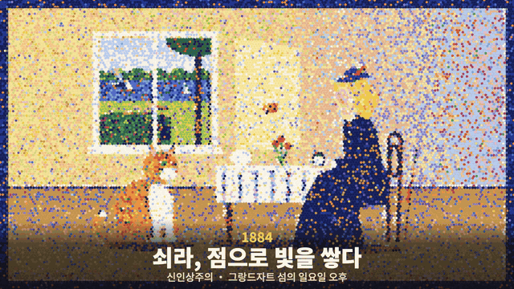
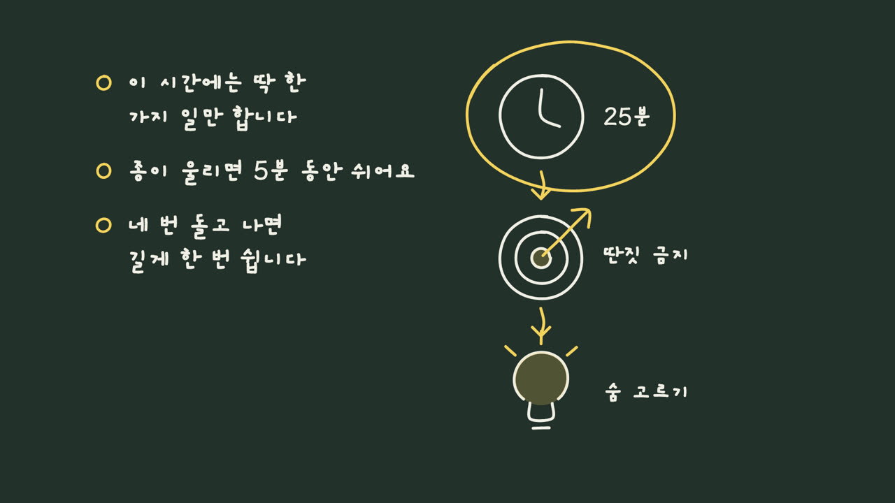

<div align="center">

[English](.github/README.md) | **한국어** | [原版 (简体中文)](https://github.com/alchaincyf/huashu-art-motion)

# ArtMotion Kit

미술 양식 36가지를 코드로 그려 움직이게 하고, 해설 애니메이션 문법 9가지를 쓰는 에이전트 스킬입니다.
**화면 글자, 자막, 내레이션이 한국어로 나옵니다.**

```sh
git clone https://github.com/neulketing/artmotion-kit ~/.claude/skills/artmotion-kit && ~/.claude/skills/artmotion-kit/l10n/apply.sh ko
```

<sub>영어로 내려면 `apply.sh en`. 다른 에이전트는 `~/.claude/skills/` 대신 그 에이전트의 스킬 폴더에 받으면 됩니다.</sub>

</div>

> **alchaincyf(花叔)의 [huashu-art-motion](https://github.com/alchaincyf/huashu-art-motion)을 바탕으로 했습니다.** MIT 라이선스.
> 원본 파일은 하나도 고치지 않고, `l10n/` 폴더에 현지화 층만 더했습니다. 한글 글꼴, 한국어 어절 줄바꿈, 한국어·영어 스토리보드 린트, macOS 내장 음성 내레이션, 한국어·영어 `SKILL.md`. 자세한 내용은 [NOTICE.l10n.md](NOTICE.l10n.md).



<sub>이 키트로 렌더한 7초 클립. 쇠라·고흐·모네 양식 장면에 한국어 자막을 얹었습니다. [MP4](https://github.com/neulketing/artmotion-kit/releases/download/l10n-demo-ko/demo_ko.mp4)에는 macOS 내장 음성(Yuna)으로 만든 한국어 내레이션이 들어 있습니다.</sub>

## 왜 따로 만들었나

원본은 훌륭한 스킬이지만 중국어 결과물을 전제로 짜여 있습니다. 안내문이 중국어이고, 화면 글꼴에는 한자만 들어 있으며, 줄바꿈은 글자 하나 단위이고, 내레이션은 중국 클라우드 음성 복제 서비스를 씁니다. 원본 영어 README도 설치되는 스킬 자체는 번역하지 않는다고 밝혀 두었습니다.

ArtMotion Kit은 **결과물**이 한국어나 영어로 나오게 합니다.

| 원본(중국 전제) | ArtMotion Kit |
|---|---|
| 중국어 `SKILL.md` | `l10n/SKILL.ko.md` / `l10n/SKILL.en.md`. 규칙은 그대로, 결과 언어만 한국어·영어로. `references/` 문서를 언제 읽을지 길잡이 표 포함 |
| 화면 글꼴: 중국어 부분집합(Noto Sans SC, LXGW WenKai) | 같은 글꼴 이름에 `unicode-range`로 한글을 붙임. 본고딕(Noto Sans KR), 본명조(Noto Serif KR), 개구체(Gaegu). 모두 SIL OFL 1.1 |
| 줄바꿈이 글자 단위 | 한글은 띄어쓰기에서 끊김 |
| 스토리보드 린트가 중국어 표만 읽음 | `l10n/scripts/lint.py`가 한국어·영어 표를 읽음 |
| 내레이션: Volcengine 음성 복제(중국 클라우드, 유료) | `l10n/scripts/say.py`: macOS 내장 음성(Yuna, Samantha). 계정·키 없음, 기기 밖으로 나가는 것 없음 |

## 무엇을 하나

| 이렇게 말하면 | 이렇게 합니다 |
|---|---|
| 「이 애니메이션 재현해 줘」 | 컷, 박자 그리드, 움직임 히트맵을 재고 메커니즘을 코드로 다시 만듭니다 |
| 「고흐/모네/바우하우스처럼」 | 한 프레임을 먼저 설계하고 움직이게 합니다. 양식 레시피 카드 36장이 출발점 |
| 「내 내레이션으로 애니메이션」 | 스토리보드 → 화풍 하나 → 월드 캔버스와 카메라 → 영상 트랙 |
| 「Kurzgesagt/Vox/화이트보드/3b1b 같은 해설 애니메이션」 | 문법을 골라 JSON spec으로 프레임 단위까지 정확한 클립을 렌더(가로, 세로, 투명 배경) |
| 「음악 깔아 줘」 | BPM 그리드, 모티프 악기 바꾸기, 엔딩 효과음을 코드로 합성 |

납품 전에는 `qa.py`가 안정성·움직임·매끄러움을 재고, `deliver.py`는 슬라이드 넘기듯 보이는 영상을 내보내지 않습니다.



<sub>화이트보드 문법 + 한국어 손글씨(개구체), 어절 단위 줄바꿈. spec: [`l10n/demo/y3_whiteboard.ko.json`](l10n/demo/y3_whiteboard.ko.json).</sub>

## 시작하기

필요한 것: [uv](https://docs.astral.sh/uv/), ffmpeg, Playwright Chromium(처음 한 번 `uv run --with playwright playwright install chromium`).

```sh
cd ~/.claude/skills/artmotion-kit
l10n/apply.sh ko
uv run --with playwright python scripts/engine/render.py --solo 09_postimp --stills 0.3 --out stills   # 고흐 양식 한 프레임
python3 l10n/scripts/say.py --text "고흐의 하늘은 왜 소용돌이칠까" --out vo.wav                          # 로컬 내레이션(macOS)
python3 l10n/scripts/lint.py storyboard.md                                                          # 한국어 스토리보드 검사
```

데모 다시 만들기: `apply.sh` 뒤에 `scripts/engine`을 프로젝트 폴더로 복사하고 [`l10n/demo/eras_ko.js`](l10n/demo/eras_ko.js)를 넣은 다음 `render.py --film ko --fps 30 --out demo.mp4`.

### `l10n/apply.sh`가 하는 일

1. 한글 글꼴(`l10n/fonts/*.woff`)을 `scripts/engine/lib/fonts/`로 복사
2. 작은 패치 세 개 적용(`l10n/patches/`)
   - `0001` 글꼴 등록: `PuHui-*`, `NotoSansSC`, `NotoSerifSC`, `LXGWWenKai-500`에 한글 면을 붙임. 기존 코드의 글꼴 이름을 그대로 쓰면 한글이 나옵니다.
   - `0002` 글리프 검사: 한 글꼴 이름에 파일이 여러 개여도 빠진 글자 검사가 맞게 돌도록 합칩니다.
   - `0003` 줄바꿈: 한글 낱말을 쪼개지 않고 띄어쓰기에서 끊습니다.
3. `SKILL.md`를 한국어판(또는 영어판)으로 교체

되돌리기: `l10n/apply.sh --revert`. 원본을 업데이트하기 전(`git pull`)에 먼저 되돌리고, 받은 뒤 다시 적용하세요.

### 한글 글꼴

KS X 1001 상용 한글 2,350자를 담았습니다(글꼴 다섯 벌 합쳐 약 2.9MB). 빠진 글자가 화면에 나오면 엔진이 오류로 알려 줍니다. 그럴 때는 원본 글꼴(github.com/google/fonts 의 `ofl/notosanskr`, `ofl/notoserifkr`, `ofl/gaegu`)을 받아 다시 만드세요.

```sh
uv run l10n/scripts/build_fonts.py --src <ttf 폴더> --text "똠햏"    # 몇 글자 추가
uv run l10n/scripts/build_fonts.py --src <ttf 폴더> --full          # 11,172자 전부(약 9.6MB)
l10n/apply.sh ko
```

### 내레이션

`say.py`는 원본 `scripts/capabilities.py say --mode system`에 목소리만 골라 넘깁니다. 한글이 있으면 한국어 음성(Yuna 우선), 없으면 미국 영어 음성(Samantha 우선)입니다. `--fit`(길이 맞추기), `--match`(원본 음량 맞추기), 48kHz WAV와 `.json` 기록, 무음 검사는 원본 기능 그대로입니다. 음성 목록은 `--list`, 다른 음성은 시스템 설정 > 손쉬운 사용 > 음성 콘텐츠에서 받습니다. macOS가 아니면 직접 녹음한 파일을 `scripts/capabilities.py use-audio`로 넣으면 됩니다.

### 스토리보드 린트

`lint.py`는 한국어(화풍/팔레트/캐릭터, 시간｜사물｜동작｜카메라｜화면 글자｜방법) 또는 영어 표를 원본 린트가 읽는 중국어 키로 바꿔서 원본 `storyboard_lint.py`를 그대로 돌립니다. 표 구조, 컷 길이, 카메라 반복, 글자 수, 화풍 잠금, 파랑·보라 색은 모두 검사됩니다. 「제목」「나타난다」처럼 자주 쓰는 빈말 몇 개도 잡지만, 한국어 낱말 목록은 원본 중국어 목록보다 짧습니다. 결과 메시지는 원본 그대로 중국어로 나옵니다. 화면 글자는 한글 어절마다 「음절 수 ÷ 2(올림)」로 세므로, 원본의 「8자 이하」가 한글 약 16음절이 됩니다.

## 라이선스

- 코드와 문서: MIT, © 2026 alchaincyf (花叔 · 花生), [LICENSE](LICENSE). 현지화 층: MIT, © 2026 neulketing.
- 글꼴은 각자의 SIL OFL 1.1을 따릅니다(`scripts/engine/lib/fonts/LICENSES.md`, `l10n/fonts/OFL-*.txt`).
- 원본의 예외 조항은 그대로입니다. Arphic 라이선스 필순 데이터, 원작자 캐릭터 그림, Clawd 팬 데모는 MIT에 포함되지 않습니다. 원본 [README](README.md#许可证) 참고.

ArtMotion Kit은 독립적인 현지화판이며 원작자와 제휴하거나 보증을 받은 관계가 아닙니다.
